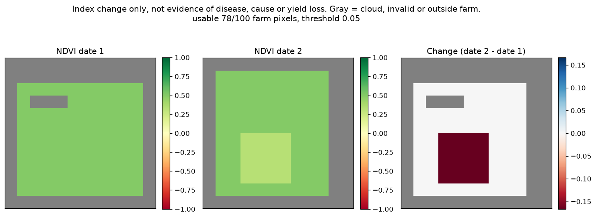

# PS07 Satellite Vegetation Change Monitor

- Problem: PS07 (Cerevyn Round 1)
- Name: Saurabh Gupta
- Roll no: 2311981465
- Course: BE CSE, Chitkara University, HP

This project takes one farm, two satellite images of it from different dates, and tells you whether the vegetation got worse. It works out NDVI for every pixel on both dates, compares them, and writes a JSON summary, a CSV and a heatmap.

NDVI is (NIR - Red) / (NIR + Red). The tricky part is pixels you can't trust. If a pixel is marked cloudy or invalid, if NIR + Red is zero, or if a value isn't a real number, it gets NaN. I never fill those with 0, because 0 looks like bare soil and would quietly drag the average down.

For each date I report how much of the farm was clear (coverage) and the mean NDVI of that date's clear farm pixels. The actual comparison only uses farm pixels that are clear on both dates. Clouds can sit in different places on the two dates, and if I compared each date's own mean, part of the change would just come from comparing different pixels. Change is date 2 minus date 1. If no pixel is usable on both dates you get `status: "no_usable_pixels"` with null means and no flag, not a crash.

A pixel counts as declined when its NDVI dropped by at least the threshold, and the farm gets `decline_flag: true` when the mean NDVI dropped by at least the threshold. The threshold is an absolute NDVI drop, 0.05 by default. You can change it with `--threshold` on the CLI, `threshold` on the API, or the `NDVI_DECLINE_THRESHOLD` environment variable (see `.env.example`). A value you pass directly beats the env variable, which beats the default.

An NDVI drop on its own doesn't show disease, its cause, or yield loss. It only says the index went down. Every result includes this as a `note`, and the heatmap says the same in its title.

Demo video: [docs/demo.mp4](https://github.com/Saurabh-1885/Cerevyn-Chitkara-2311981465-PS07/blob/main/docs/demo.mp4) (GitHub won't play it in the browser, so download it).

CI runs the tests on every push: [.github/workflows/ci.yml](.github/workflows/ci.yml). The Azure deployment in [docs/azure-plan.md](docs/azure-plan.md) is a design only. Nothing is deployed.

## Setup

You need Python 3.11 or newer. CI uses 3.11 and I worked on 3.14.3. On Windows:

```
git clone https://github.com/Saurabh-1885/Cerevyn-Chitkara-2311981465-PS07.git
cd Cerevyn-Chitkara-2311981465-PS07
python -m venv .venv
.venv\Scripts\activate
pip install -r requirements.txt
```

`requirements.txt` pins numpy 2.4.6, matplotlib 3.11.2, fastapi 0.143.1, uvicorn 0.54.0, python-multipart 0.0.32, httpx 0.28.1 and pytest 9.1.1.

## Run

With no arguments the CLI runs on the sample data and writes `outputs/results.json`, `outputs/results.csv` and `outputs/heatmap.png`:

```
.venv\Scripts\python report.py
.venv\Scripts\python report.py --threshold 0.03
```

Use `--date1`, `--date2` and `--farm` to point it at your own files and `--out` for a different output folder. Each run overwrites the files in that folder.

Inputs are NumPy `.npz` files and all arrays must be 2D with the same shape. A date file has `red` and `nir` (floats) and `valid` (bool, True = clear pixel). The farm file has `farm` (bool, True = inside the farm). A missing key, a file that isn't an `.npz`, or shapes that don't match give a clear error: the CLI prints `error: ...` and the API answers 422.

To start the API:

```
.venv\Scripts\python -m uvicorn app:app
```

Then open http://127.0.0.1:8000/docs. If port 8000 is already in use, add `--port 8765` and use that port instead. `POST /compare` takes optional `date1`, `date2` and `farm` uploads (any you skip fall back to the sample file) and an optional `threshold`. It returns the result and writes the outputs, which you can then download from `GET /results.json`, `/results.csv` and `/heatmap.png`.

## Tests

```
.venv\Scripts\python -m pytest
```

There are 17 tests in `tests/`. The checks the brief asks for are covered by:

- NIR 0.6 and Red 0.2 gives NDVI 0.5: `test_known_value`
- zero denominators get NaN and are left out: `test_zero_denominator_is_nan_and_excluded`
- a fully masked area: `test_entirely_masked_area_has_no_usable_pixels`, plus `test_sample_all_cloud_has_no_usable_pixels` and `test_all_cloud_date2_has_no_usable_pixels` on the sample files
- different cloud masks on the two dates: `test_different_cloud_masks_use_intersection`

The rest check that invalid pixels are NaN and not 0, that the threshold changes the flag, that bad shapes, missing keys, junk files and negative thresholds are rejected, that the sample run matches `sample_data/expected.json`, and that the API serves the output files.

## Sample output

Everything in `sample_data/` is synthetic and made by `make_sample.py`, with no randomness, so it comes out the same every time. The grids are 12x12 and the farm is everything except the 1-pixel border, so 100 pixels. A healthy pixel has NIR 0.6 and Red 0.2, which is NDVI 0.5. On date 1 the top 2 rows are cloudy and three farm pixels have Red and NIR both 0. On date 2 the right 2 columns are cloudy and a 4x4 patch drops to NIR 0.4 (NDVI 0.333). `date2_all_cloud.npz` is date 2 with every pixel cloudy, for the no-usable-pixels case. `sample_data/README.md` works out the expected numbers by hand.

`python report.py` writes this to `outputs/results.json`:

```json
{
  "status": "ok",
  "farm_pixels": 100,
  "date1": {
    "valid_pixels": 87,
    "coverage_pct": 87.0,
    "mean_ndvi": 0.49999999999999994
  },
  "date2": {
    "valid_pixels": 90,
    "coverage_pct": 90.0,
    "mean_ndvi": 0.4703703703703703
  },
  "usable_pixels": 78,
  "usable_pct": 78.0,
  "mean_ndvi_common_date1": 0.4999999999999999,
  "mean_ndvi_common_date2": 0.46581196581196577,
  "mean_change": -0.03418803418803418,
  "threshold": 0.05,
  "declined_pixels": 16,
  "declined_pct": 20.51282051282051,
  "decline_flag": false,
  "note": "An index decline does not by itself establish disease, cause or yield loss."
}
```

78 farm pixels are clear on both dates. The 16 patch pixels each drop by 1/6, so 20.5% of the usable pixels declined. Spread over all 78 pixels, though, the mean change is only -0.034, which isn't a 0.05 drop, so the farm isn't flagged. With `--threshold 0.03` it is.

The heatmap shows NDVI on date 1, NDVI on date 2 and the change. Gray is cloud, invalid or outside the farm.



## Limitations

I've only tested it on synthetic data, not real satellite images. It only does NDVI. There's no georeferencing or reprojection, so both dates and the farm mask have to be the same grid already. Cloud masks have to come with the data in `valid`; the tool doesn't detect clouds. Every pixel counts the same regardless of its area. Outputs only go to a local folder with no history, so it's meant for one user at a time.

## How I used AI tools

AI tools drafted the first versions of most files: the code in `ndvi.py`, `report.py` and `app.py`, the sample data script `make_sample.py`, the tests, the CI workflow, the Azure plan and the text of this README.

I picked PS07 and decided the rules the code has to follow: invalid, cloudy and zero-denominator pixels get NaN and never 0, the comparison only uses farm pixels valid on both dates, the default threshold is 0.05 as an absolute NDVI drop, and the export is a JSON summary, a CSV and a heatmap. I ran the tests, the CLI and the API myself, read through the code, and I can explain any part of it or change it when asked. The sample numbers can be checked by hand from the layout described in `sample_data/README.md`.
